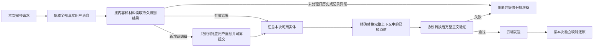

# 历史消息持续脱敏方案

日期：2026-10-30。状态：核心路径已实施，尚未完成全部设计与发布验收。当前运行的 beta.13 未被替换。实现范围、验证证据和未完成项见[实施记录](redaction-history-implementation-20261030.md)；以下仍是完整目标方案，不能把设计条款视为已通过的验收。

## 1. 默认方案与保护边界

**按用户消息可靠保存识别结果，持续复用；只对新增用户消息和被修改的用户消息调用本地识别模型。每次出站仍使用这些结果，对完整上下文统一做已知敏感值的替换。**

历史用户消息内容及识别材料未变时，直接读取保存的结果；助手长回复、工具参数和工具结果不进入新实体识别。服务重启和内存缓存淘汰不应导致整段历史重新推理。无法确认的历史先阻断，通过单独、可见、有界的本机补处理任务解决，不能悄悄全量扫描。

本方案保护的是**用户输入中已经识别出的敏感信息，在后续历史和回显中继续保持脱敏**。工具首次返回的新秘密、助手自行生成或推导的生日/地址等新信息，不因此获得新实体识别；不能把“已知值替换通过”宣传为“全部业务文本均识别过”。识别器本身的漏检也不由持久复用解决。

## 2. 必须分开的三种状态

| 对象 | 作用 | 生命周期与失败规则 |
| --- | --- | --- |
| 用户消息识别记录 | 保存该条实际用户输入的完整识别结果，包括零命中 | 私有、持久、可校验；没有普通性能 TTL，不因重启、LRU 或页面访问删除 |
| 内存性能缓存 | 缓存已经校验的记录、索引和匹配器 | 可淘汰；失效回读持久记录，不能直接转为历史重识别 |
| 本次请求还原表 | 记录本次实际发出的占位符与原值 | 请求独立，不作为会话全局字典；响应结束释放 |

识别记录与已有的 `redaction_observations.sqlite`、请求账本分开。观察记录用于本机展示，不具备完整材料、覆盖及持久化承诺，不能直接升级成可复用的识别依据。

## 3. 按实际用户消息识别和复用

### 3.1 稳定的内容指纹

按原始合法协议解析所有用户消息。WorkBuddy / Loomy 对每一轮分别提取实际提示词，剔除其已知宿主包装；工具结果即使放在 Anthropic 的 user 消息内部，也不是用户的新输入。

每条用户消息的多个实际文本块组成一个有序、带类型和字节长度边界的对象。对精确 UTF-8 内容计算持久密钥下的 HMAC；不擅自 trim、折叠空白或 Unicode 归一化。宿主环境提示、历史绝对下标、供应商和无关元数据变化不应让真实提示词失去复用。

建议键为：

```text
resultKey = HMAC(Kindex,
  installationScope, authenticatedAppScope,
  userProjectionVersion, recognitionMaterialId,
  canonicalActualUserMessage)
```

`authenticatedAppScope` 来自服务认证结果，包括应用及其授权域；不是客户端自报字段，也不包含实际 API Key。撤销应用授权时须更新对应授权代次。切换云端供应商或轮换供应商 API Key 本身不改变用户消息的识别语义。

客户端 message_id / session_id 仅作关联线索。查到同 ID 后仍须核对实际内容、授权域和识别材料；同 ID 改了文字，原记录不能命中；换 ID 但内容完全相同，可以复用同授权域内的纯识别计算结果。

### 3.2 记录内容

```text
UserRecognitionResult
  recordId, schemaVersion, keyId
  authenticatedAppScope, projectionVersion
  contentFingerprint, canonicalEncodingVersion
  recognitionMaterialId
  messageByteLength, blockLengths, chunkCoverage
  complete=true
  entities[] = block/range/category/originalValueDigest
  encryptedSensitiveValues[]  可用于有可信关联的历史残留清理
  createdAt, recordRevision
```

实体坐标必须能在本次提供的用户原文中重新校验；完整性标志、零命中结果及全部分块覆盖也必须通过鉴别，不能信任数据库里一个未受保护的 complete 列。

不保存整段用户原文、助手长回复或工具输出。实体范围、类别和必要敏感原值作为私有加密载荷保存；原消息仍在请求中时，优先从已核验的当前字节重建原值。保存原值不是向任意会话提供全局替换字典。

修改消息时，重新识别**修改后的整条用户消息**，不是只识别新增几个字，以保留该条消息内部的判断上下文；其他未修改消息继续复用。

## 4. 私有持久化、重启恢复和版本

### 4.1 存放与保护

通过真实 `dirs.Layout`，在 `<state>/redaction-results/` 存放独立 SQLite 数据库与受保护的密钥包；复用完整旧 api-router 布局，不创建第二套配置。启动时拒绝链接、重解析点和异常目录，不在仓库、程序安装目录、临时目录或公共日志中保存记录。

Windows 首期采用当前用户范围的 DPAPI 包装随机主密钥，禁止使用 LOCAL_MACHINE 范围，后台调用禁止弹出 UI；目录和数据库、日志、密钥包均核验私有 ACL，不能用 chmod(0600) 代替 Windows ACL 验证。DPAPI 的用户和设备约束意味着跨用户或跨设备复制文件不等于可恢复。[Microsoft 的 DPAPI 说明](https://learn.microsoft.com/en-us/windows/win32/api/dpapi/nf-dpapi-cryptprotectdata)

由主密钥分离索引密钥与数据加密密钥；实体载荷使用 AES-256-GCM，每次写入随机 nonce。记录 ID、授权域、指纹、材料、schema、revision 和完整性状态纳入鉴别数据，防止交换记录、篡改零命中或把未完成结果改成完成。查询索引不出现原文或敏感原值。

主密钥和索引密钥不会每次启动随机重建。正常重启、同用户升级复用原密钥包。密钥包丢失、解密失败、数据库损坏不能触发自动初始化空库或明文存储；保留现场，进入异常处理。其他平台须完成其系统密钥保护及权限后端验收，不能把 Windows 验收当作跨平台完成。

密钥包与数据库都绑定同一 storeId。首次创建须先可靠发布密钥包，再初始化数据库；崩溃后的部分初始化只按可验证的初始化记录恢复，不能猜测后重置。备份使用一致的数据库快照及其所需密钥版本，不能在运行中普通复制数据库后假设完整；恢复须核验这套对应关系。密钥轮换先可靠保存新密钥，再允许数据库引用新 keyId。

### 4.2 可靠记录不等于持久缓存

识别记录没有 15 分钟到期删除规则。保持所需历史记录，直到用户/可信宿主删除关联、执行清理或明确的数据保留策略生效。内存层可沿用 128 项、16 MiB 等容量策略；淘汰后批量从持久层读取，不增加识别调用。

建议首期持久库限额为 256 MiB，属于待实测的初始配置。达到限额时先处理可回收的无引用记录；仍不足则阻断新增记录并提示整理或调整限额，不能静默淘汰仍在使用的识别结果。不要在启动时解密并加载所有历史；按本次请求的消息键批量读取。

无法可靠追踪会话生命周期的兼容宿主，其记录作为未决引用保留，不能在一次请求结束或句柄缺失时当作无引用自动回收。

### 4.3 兼容规则

区分三类版本：

- **存储 schema / 加密封装版本**：经明确迁移、事务和备份处理；未知新 schema 保留并停止写入。
- **识别材料版本**：实际模型/权重、模板/提示词、标签、规则、字典、分块和坐标校验等会影响识别结果的材料。默认精确匹配；不兼容记录不算完整，进入有界补处理流程。
- **出站策略版本**：上下文遍历、占位符分配、最终检查和响应还原。只改变这些内容时，重新做本机重写及验证，不应自动要求历史重新推理；但须证明识别范围和实际材料未改变。

普通页面、版本号或供应商变化不应全量作废识别记录。只有经测试和评审的兼容声明才能跨材料复用，不允许“看起来差不多”的自动兼容。密钥轮换通过 keyId 解密旧记录并重新封装；旧密钥在所需记录完成迁移前不能删除。

## 5. 并发、提交和崩溃

持久层建议采用 SQLite `journal_mode=DELETE`、`synchronous=EXTRA`、外键及有界 busy timeout；密文也须先可靠提交，才能被标为“已保存可复用”。EXTRA 在 DELETE 模式下补充提交所需的目录同步；仍需文件系统与断电恢复测试，不能仅据 pragma 声称绝对不会丢失。[SQLite 同步规则](https://www.sqlite.org/pragma.html#pragma_synchronous)、[原子提交说明](https://www.sqlite.org/atomiccommit.html)

- 服务是唯一在线写入者；离线管理须先取得对应服务布局的排他锁。SQLite 事务与唯一键作为额外的并发边界。
- 同一 resultKey 的重复请求合并识别等待；不在全局锁或数据库写事务里做推理。无关消息可以独立准备，共享模型队列和资源上限。
- 识别结束后，重新核对原文指纹、材料和期望消息修订号；在短事务中提交完整结果及消息关联。冲突采用比较并交换，不让旧请求覆盖已编辑消息的新版本。
- 新识别结果提交失败，该业务请求阻断；不能先以“只存在内存”发送，再把可靠保存当作尽力而为。
- 进程在提交前崩溃，不得留下可命中的半条记录；提交后、发送前崩溃，重试直接复用已提交结果。pending / 分批任务进度不等于 complete。
- 删除/编辑使关联的 generation 变化；持有旧 generation 的准备结果在出站前重新确认。已开始发送的请求不能撤回，响应继续使用它自己的不可变还原快照，不能切换成新版本映射。

## 6. 会话、编辑、删除和历史截断

持久计算结果与会话关联分开：`UserRecognitionResult` 按内容校验；`MessageBinding` 将服务内部的会话、消息 occurrence、内容版本关联到记录。两个会话可在同授权域内复用完全相同原文的识别计算，但不共享占位符编号、还原表或一份任意可取的私有字典。

### 6.1 请求能使用哪些结果

默认只选取**本次实际携带且可核验的用户消息**对应的结果。没有这些原文，不能仅凭客户端 session_id 或 message_id 读取旧敏感值并授予还原权。

可靠的会话生命周期由服务持久保存的、绑定应用的随机会话句柄及修订记录管理；宿主本身的 ID 只作线索。句柄在同用户正常重启后可继续核验，不能沿用 beta.13 进程随机签名一重启即失效的规则。宿主未回传句柄时，仍可按完整用户原文做识别复用；但不能假设已经获得编辑/删除/不透明续写的可信会话关联。

服务保存该会话已知用户 occurrence 的内容指纹与 revision，以识别新增和编辑；客户端提示的 ID 只用于定位待验证关联。无可信关联时，历史中无法匹配记录的新文本归入“未处理旧历史”，不根据一个自报 ID 自动认定为已授权编辑；可见补处理只处理该条缺失的用户消息，其他有效历史仍不重扫。

### 6.2 编辑与删除

- 编辑产生不可变的新内容版本，只识别被改的消息；新版本提交后更新该 occurrence 的活动关联。旧结果不覆盖新结果，也不影响其他仍引用旧文本的会话。
- 旧助手/工具可能仍回显被编辑或删除前的号码。若有可核验的会话关联，保留该会话所需的旧实体作**残留值清理**，只匹配本次确实出现的原值；不重新识别助手或工具，不让这些旧值单凭占位符获得响应还原权。
- 源消息删除/编辑后留下旧回显，但宿主无法提供可信关联时，不能从其他会话或整个应用库借一份旧字典。要求宿主清除相关分支/重同步可核验历史，无法确认时阻断。实现前须实测 WorkBuddy / Loomy 的会话与编辑事件能力；不能承诺缺少该能力的宿主具有完整的无感删除处理。
- 一次请求未携带某条消息，可能只是上下文截断，不等于用户执行删除，不据此清除持久记录。
- 明确删除会话时，在认证后的事务中撤销绑定和复用权限、提高 generation、清除对应内存索引，并回收无其他引用的结果。共享识别结果按引用计数处理。
- “彻底忘记这条识别结果”同时撤销仍依赖它的历史保护状态；如上下文中还有旧值，必须重同步或重新授权补处理后才能发送。不能一边宣称忘记，一边继续隐式使用旧值。

逻辑删除及权限撤销需要可靠提交。密文的磁盘和备份物理残留另按本机删除策略处理；`secure_delete` 不代表所有介质和备份上的绝对擦除。

## 7. 正常路径的本地推理量

| 情况 | 本地模型处理量 | 其余工作 |
| --- | --- | --- |
| 新增 1 条用户输入，前面 H 条未变 | 只识别新增的 1 条用户消息 | 批量读取 H 条记录，整份上下文精确替换 |
| 修改历史第 k 条，其余未变 | 只重新识别第 k 条的完整实际输入 | 其余历史读取原记录；不重识别助手回复 |
| 相同请求重试、相同消息被标题请求再次使用 | 有兼容完整结果时为 0 | 按实际目标重新重写及校验 |
| 仅工具回调，用户消息均有有效记录 | 0，包括新增很长的工具输出 | 用已有用户实体做精确匹配与替换 |
| 内存缓存淘汰后重放未变历史 | 0 | 从私有持久库读取 |
| 服务重启后，未变历史均有兼容记录 | 历史部分为 0；有新用户输入则仅处理新消息 | 解封密钥、批量读取、构建本次匹配器 |
| 材料不兼容、旧历史首次出现或记录损坏/丢失 | 默认业务请求中不自动补扫历史 | 先阻断，再进入第 8 节的可见补处理 |

表中的无感编辑路径要求第 6 节的可核验关联；不具备这一能力的宿主走单条可见补处理，不以全量重识别代替关联校验。

模型调用次数由新增/编辑消息自身的分块和批次决定，不承诺“一条消息必定一次调用”。无变化历史、助手长度和工具输出长度不应增加新实体识别调用。

计算量分两部分：模型工作量随新增/修改的**用户文本**增长；JSON 解析、记录查询、精确匹配和最终检查随本次完整上下文大小增长。后者仍要有字节、实体、CPU 时间和取消上限，但不应变成本地模型推理。以批量查询和按本次实体构建的最长匹配器控制开销，不逐消息逐轮重新初始化模型。

## 8. 未处理旧历史、损坏和材料不兼容

默认自动历史补识别数量为 **0**。请求开始先盘点所有历史用户消息的记录状态，在任何推理和云端尝试前报告缺失/不兼容条数，不能扫到一半才发现历史很大。

- 单条明确的新用户输入或有可靠关联的编辑消息，走正常增量识别，沿用现有每请求最长 30 秒及模型更短预算、64 个新扫描块等上限；同请求的全部增量共用截止时间。
- 未知旧历史、历史记录损坏/丢失、识别材料不兼容，返回明确的 `redaction_history_prepare_required`；材料/数据库/密钥错误分别保留诊断。云端调用数必须为 0。取消、重试和切换供应商不能绕过。
- 页面列出“待补处理 n 条用户消息、约 m 字符”，提供明确的本机补处理入口。只处理用户选择且请求实际提供的用户原文，不处理助手/工具长文本，不发送云端。
- 补处理任务每步最多执行一个现有识别批次（最多 16 字段 / 2048 码点），每步最长 30 秒或更短模型预算。建议首期每个任务最多选择 100 条用户消息、20 万码点，以先达到者为限；显示总量、进度、取消和暂停，不无限扩大范围。任务按低优先级分批排队，每批结束让出模型队列，不能连续占住所有新请求的识别机会。
- 长用户消息可分多步，严格校验分块重叠与完整覆盖，只有整条消息完成后才产生可复用完整记录。已完成消息逐条提交，任务中断不回滚它们，下次继续不重扫已完成消息。
- 分步中间状态与完整记录分开存放。任务重启后若原文不在内存，要求宿主重新提供原文并核对指纹；不能把不完整结果当作已完成，也不为恢复任务另存整段明文历史。
- 数据库暂时不可读、密钥不可用、未知 schema 时保持阻断，不自动删库重建。单条坏记录先隔离，不能用未认证的旧内存副本绕过删除/版本变化。

这种策略在首次升级使用旧会话时可能需要一次可见准备；正常持久记录建立后不随每轮历史增长持续增加推理量。需要压测并报告这一一次性成本，不能隐藏为普通请求的随机长等待。

## 9. 完整出站的已知值替换与检查



1. 固定应用授权域、有效模型材料和出站策略。逐条确认所有实际用户输入有完整、可校验的结果；零命中也需要完整记录。
2. 从本次合法用户原文及有可信会话关联的残留清理记录汇总已知原值，统一处理分类、重叠与最长匹配，不拼接各记录里独立的 `:1`。
3. 对历史 user 的实际提示词按来源位置替换；对助手文本、可读推理摘要、工具参数的字符串值、工具结果及会话摘要，只做同一套已知完整值精确匹配，不调用识别模型。
4. 对允许改写的 system/developer 普通文本和宿主包装应用同样的已知值规则，不做新实体发现。键、工具名、schema、消息 ID 等不能安全改写的控制字段若出现已知完整原值则阻断；数字标量遇已知值不能安全表示时也阻断，不宣称通用数值新识别。
5. 对原始来源标记经过的真实协议转换、ExtraBody 扩展后的最终正文，检查用户消息覆盖、已知原值残留、位置和类型、字面占位符碰撞及协议合法性。检查解码后的字符串，不能只 grep 原始 JSON 字节漏掉转义。
6. 检查只跳过程序实际生成且有来源证明的占位符范围，不能跳过所有“看起来像占位符”的字符串。保留严格的完整值、大小写及边界规则，不将普通单字或号码子串全局替换。
7. 执行器只发送验证后的不可变正文。任何重试、路由组回退、原生 token 计数、标题或携带用户数据的连接验证都走相同边界。prepared 与实际开始发送分开记录。

图片、音频、不透明加密内容及不可改写签名块沿用明确的文本能力边界：不能验证时拒绝相关路径，不宣称其中已有新实体识别。仅有 `previous_response_id` 等云端引用时，需要本服务可核验的完整前序保护链；没有证据则要求宿主提供历史正文或阻断。

## 10. 占位符和 JSON/SSE 还原

- 单次请求统一分配占位符：同一原值一致，不同原值不同。先汇总实体再分配，解决多条消息各自 `:1` 的冲突。
- 保留全部输入字面占位符，使用有版本的随机请求命名空间，不能让用户输入 `<GOVERNMENTID:1>` 读出以前的原值。
- `RestorationSnapshot` 只含本次确实生成并写入允许出站位置的占位符。持久库中有某条记录，不等于云端可以通过任意 token 取出它。
- 同授权域不同会话、不同应用以及并发请求互不共享还原表。内容相同的识别计算复用不传递占位符权限；仅有会话 ID、另一个会话的 token 或缓存条目不能完成还原。
- JSON、SSE 跨事件 token、工具参数、多个工具通道和可读推理通道使用同一不可变快照；先适配回客户端协议再还原。错误中断响应，不能退回原始未受控响应。
- Chat / Responses / Anthropic 的每种源到目标组合都保留私有来源标记；转换丢失、覆盖用户来源或重新注入原值时失败关闭。
- 每次携带的完整上下文统一渲染，首期不承诺跨请求 token 编号恒定。随机命名空间可能降低云端前缀缓存命中；这是性能测量项，不能为了命中率共享未经核验的全局映射。

## 11. 页面与审计

界面分别显示以下事实，不用一个“命中 1 项”概括：

| 区域 | 必须显示的事实 |
| --- | --- |
| 当前用户输入 | 新识别 / 复用 / 零命中 / 失败，命中数、模型实际调用和耗时 |
| 历史用户消息 | 总数、持久结果复用数、编辑重识别数、缺失/损坏/不兼容数 |
| 助手与工具历史 | 已知值替换数量；明确标注“未进行新实体识别” |
| 完整出站检查 | 已知值保护通过 / 阻断、范围版本、失败位置类型 |
| 云端尝试 | 实际未发送 / 已开始发送，与 prepared 分开 |

例如：“历史用户消息 20 条，复用 20 条；新增用户消息 1 条；本地识别仅处理新增消息；历史已知值替换 3 处；完整出站检查通过。”只有真正开始云端尝试后才显示已发送。

重启恢复只显示“从本机识别记录恢复复用”；若工具返回新秘密，不把本地调用数 0 或替换数 0 当成“工具输出无敏感信息”的证明。

账本持久保存计数、材料/策略版本、记录来源、失败阶段和正文证明摘要，不新增整段历史明文、工具正文或请求还原表。删除观察记录与删除可靠识别结果是两个不同操作，页面须说明各自影响。

## 12. 实现拆分与迁移

| 位置 | 需要的工作 |
| --- | --- |
| `cloudcodec/user_input.go`、`user_prompt.go` | 提供全部真实用户消息的规范视图；保留当前输入专用 UI 视图；工具结果不得混入识别范围 |
| 新的私有识别记录模块与 `dirs` | 内容索引、加密载荷、权限/密钥、schema 迁移、事务、关联修订和补处理任务 |
| `routerredact/pipeline.go`、`user_input.go` | 按消息读取完整结果、增量识别、提交后发布；覆盖完整上下文的已知值替换与最终检查 |
| `routerservice/runtime_redactor.go`、session/host 适配 | 不再将当前提示词缓存当作整个请求的依据；可靠会话关联与无句柄兼容策略；共享截止时间 |
| `mapping.go`、`stream.go`、各协议转换 | 统一占位符、独立还原权限、JSON/SSE 及转换后的残留检查 |
| 观察 API、请求账本与页面 | 当前识别、历史复用、已知值替换、最终检查和实际发送分别展示 |

先建立持久记录与增量路径，再修复完整出站边界及还原，最后接入补处理页面、迁移和打包。不能只改 UI 或把所有历史再送一次模型就标记完成。

beta.13 的观察库不能直接作为可信识别记录导入。升级后遇到未处理的旧历史走明确补处理；已在新版可靠保存的结果，在兼容更新和正常重启后必须继续复用。数据库或密钥迁移失败保留旧资料，禁止自动清空或用未脱敏链路兜底。实现前须验证目标宿主能提供哪些可信关联；不支持的删除/编辑残留路径应作为发布限制明确阻断。

## 13. 验收设计

模拟云端捕获最终正文，同时用计数器记录每次本地识别实际接收的用户消息和字符数；断言既要防漏传，也要防止多扫。模型/云端使用合成数据与本机模拟接口。

1. **既有两轮号码泄漏复现**：第一轮合成身份证号，第二轮只追问。两次云端正文都没有原号；第二轮历史有占位符，本机回答可正确还原。
2. **历史不变**：20 条有效历史加 1 条新增用户消息，识别器只看到新增消息；旧历史新增再多助手文字也不增加模型调用。
3. **历史编辑**：只修改第 k 条，识别器只接收修改后的这一条；其他 19 条复用。伪造或复用客户端 ID 不能跳过内容验证。
4. **仅新增输入**：新增两条时仅处理这两条；换消息 ID、变化宿主环境或更换云端协议而实际用户文本不变时仍可复用。
5. **重启恢复**：关闭服务、清空全部内存对象，以同一私有库和密钥重启，给历史识别调用设置失败断言；未变历史本地调用为 0，新输入仅调用自身。
6. **性能缓存淘汰**：LRU/TTL 失效只导致持久读取；不得触发历史模型调用。长助手/工具输出只增加解析、匹配工作，压测其有界耗时及取消。
7. **工具回调**：所有用户结果有效时，新工具结果的本地调用为 0；结果里的已知号码被替换。首次出现的新秘密作为负向范围用例，确认 UI 不声称已经识别它。
8. **异常记录**：丢失、坏 AEAD、完整性标志篡改、错误内容指纹、未知 schema、错误材料和密钥不可用均不得明文出站；默认未知历史不自动调用模型。
9. **显式补处理**：只识别选定的历史用户消息，单步批次与截止时间有界；中断/重启后已完成记录不重扫，未完成记录不能放行。
10. **并发/崩溃**：重复消息合并识别；编辑与旧请求写入竞争、删除与出站竞争、提交前后故障、磁盘满/权限错均符合事务和 generation 规则，不发布半条或被删除结果。
11. **隔离与冲突**：两条不同号码各自结果内都是 `:1`，统一输出后不冲突；跨应用/会话、伪造会话句柄、字面 token、另一个请求的 token、旧缓存均不能错误还原。
12. **编辑/删除残留**：可信会话下旧助手/工具回显继续做旧值清理，新的用户消息只识别自身；无可信关联时相关路径明确阻断，不借用其他会话字典。
13. **协议及流式**：WorkBuddy / Loomy、Chat / Responses / Anthropic 九种转换、JSON/SSE 拆分、工具参数和各通道独立映射全部覆盖。
14. **最终边界**：最后一条历史、转义原值、ExtraBody 注入、不可改写字段、不透明续写、取消和供应商回退均断言最终正文安全或云端调用为 0。
15. **版本**：纯出站格式/页面更新不触发历史重识别；真正材料不兼容不静默复用，进入可见补处理；密钥正常轮换不全量重跑模型。
16. **页面**：当前命中、历史复用、助手/工具仅已知值替换、完整出站检查及实际发送分别验证；两浏览器、五语言覆盖。

实现时先在 beta.13 上证明关键泄漏回归失败，再在修复版验证上述出站与调用量断言。还需按仓库规则完成受影响包、race、宿主、协议、持久化崩溃恢复及完整发布检查。本设计稿本身不表示这些实现测试已经通过。
